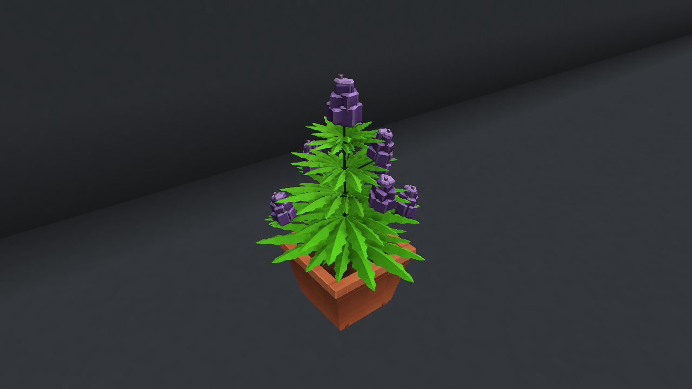

# Stonedew

A Minecraft Java **1.21.1 / NeoForge 21.1.264** mod about a cozy underground cultivation cave, colorful strains and an unsettling mystery.

**Current milestone: P1 — Plant Core.** Plant seeds, water individual plants, fuel lamps, and grow through four visible stages to ripe buds. Includes one-slot pots, four-slot beds, persistent genome identity, a plant HUD and a working Ledger directive screen. Harvest/processing, room simulation, consumption, worldgen and automation remain in later phases.

[**Download stonedew-0.2.5-p1.jar**](https://github.com/sh0oyu/Stonedew/raw/refs/heads/main/downloads/stonedew-0.2.5-p1.jar)

## Install

1. Install [NeoForge 21.1.264](https://maven.neoforged.net/releases/net/neoforged/neoforge/21.1.264/neoforge-21.1.264-installer.jar) for **Minecraft Java 1.21.1**, using **Install client**. Launch that installation once, then close it.
2. Open its game directory (Launcher → Installations → NeoForge profile → folder icon). Put the downloaded JAR in `mods`, creating the folder if necessary. **Remove older Stonedew JARs**; keep only one Stonedew JAR. Do not extract it.
3. Launch the NeoForge installation. No other mods are required. Use the launcher's Java 21 runtime.

Back up existing worlds before updating development builds. P0 worlds can load P1; do not downgrade P1 plant saves to P0.

## First grow

Start a disposable Creative world with commands enabled. The Stonedew tab contains equipment, four seed colors, a full can and Glow Cells. `/stonedew debug givekit 0` supplies a kit too.

1. Place a **Clay Pot** or **Planter Bed**. Right-click soil with a **Wild Seed**. Beds have four planting positions.
2. Right-click foliage or soil with the **Tin Watering Can**. A successful pour adds water and uses one of eight pours in Survival. Refill at source water or a water cauldron.
3. Place a **Bulb Lamp** above/near plants and right-click it with a **Glow Cell**. Each cell supplies one Minecraft day of fuel. The lit lamp contributes Lume within five blocks.
4. Aim at foliage to inspect stage, water, Lume and Vigor. Plants sway and change form as they grow. Poor care slows growth without killing plants. Normal growth takes roughly an hour with good care, longer with poor care.
5. Open a placed **Ledger** to follow the introductory directive. Ripe plants are the P1 endpoint; harvesting arrives in P3.

For a quick visual exhibit, stand in clear space and run `/stonedew debug demo`. It checks a 14×10×7 loaded air volume beside/above you before building a grow room, refusing occupied space. Use a disposable world. This is a developer exhibit, not world generation.

Operator tools (permission level 2):

- `/stonedew debug grow 240000` — accelerate the targeted tray.
- `/stonedew debug setstage 0` through `3` — select a stage.
- `/stonedew debug genome show`, `random`, or `set pigment teal teal` — inspect/change a targeted genome.
- `/stonedew debug appearance 42` — set the targeted plant’s repeatable visual identity and report its mature bud count.
- `/stonedew debug timewarp 1` — advance the growth clock one day; scheduled visits apply bounded catch-up.
- `/stonedew debug status`, `story`, `probe` — inspect definitions and persistent world state.

See the [eight-step playtest and remaining placeholders](docs/P1_PLAYTEST.md). Debug entries for later systems report that they are deferred.

## Art direction

The unchanged **CODEX_REFERENCE_NEW** sheets and supplied grow-room image remain the visual target. This rebuild uses individually serrated flat leaflets, offset solid flower bracts, modeled bevels, painted material detail and ray-baked vertex ambient occlusion. Every working equipment model has been revised; the bed now has a full-height reinforced timber body and the can is blue-gray cast metal. Fueled UV lights have pale tube cores, local colored light, floor spill and a subtle shaft.

Four saved branch layouts, three mature flower loads (5/9/13) and persistent size/rotation variation remain. Bud loads remain visual until P3 harvesting.

`/stonedew debug art` builds a checked, labeled reference-art gallery in clear loaded space. It includes all four pot, all four UV and all four tent designs. Future-tier models are **display previews**, without automation gameplay. Working P1 equipment remains in the Creative tab.



[Green/orange plant](docs/screenshots/p1-rebuilt-kush.png) · [Reference catalog](docs/screenshots/p1-rebuilt-catalog.png) · [Equipment](docs/screenshots/p1-rebuilt-equipment.png) · [Rendering/source notes](docs/art/ART_DIRECTION.md)

These are actual game captures. Baked/local shading is included; the promotional image's full scene shadows and HDR bloom require a compatible shader renderer/pack. No shader pack is bundled or claimed tested. See [asset sources/status](ASSETS.md).

## Develop

Install a **Java 21 JDK**. Ordinary builds use the checked-in assets. Regenerating artwork requires Python 3 and Blender 4.x for ray-baked vertex shading. Windows uses `gradlew.bat`.

```sh
python3 tools/generate_game_assets.py
python3 -m unittest discover -s tools -p 'test_*.py'
./gradlew runData
./gradlew build       # build/libs/stonedew-0.2.5-p1.jar
./gradlew runClient
```

Run datagen and build separately when resources change. In this cloud environment, first run `source /workspace/.stonedew-env/activate.sh` in each shell; see [cloud startup](docs/CLOUD_DEVELOPMENT.md).

Growth tuning is in `src/main/resources/data/stonedew/stonedew/environment_profiles/herb.json`. `/reload` validates and atomically replaces definitions. See [datapack format](docs/DATAPACKS.md).

Settings are in `config/stonedew-server.toml` and `config/stonedew-client.toml` (`run/config/` in development), also under Mods → Stonedew → Config. Future-system controls gain behavior with their phases.

- [Living design](DESIGN.md), [decisions](DESIGN_DECISIONS.md), [changelog](CHANGELOG.md), [architecture](docs/ARCHITECTURE.md).
- Original brief/images remain at the repository root. Full scope is retained. Automation waits for approval after the **P3 Fun Gate**.

Official Mojang mappings: [license](https://github.com/NeoForged/NeoForm/blob/main/Mojang.md). Code/assets are All Rights Reserved pending the owner's license choice. Build tooling follows the NeoForge MDK (LGPL-2.1 template notice in `TEMPLATE_LICENSE.txt`).
