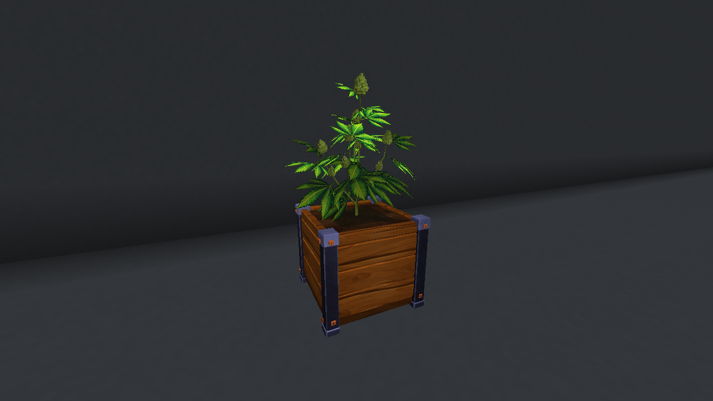

# Stonedew

A Minecraft Java **1.21.1 / NeoForge 21.1.264** mod about a cozy underground cultivation cave, colorful strains and an unsettling mystery.

**Current milestone: P1 — Plant Core.** Plant seeds, water individual plants, fuel lamps, and grow through four visible stages to ripe buds. Includes plantable pot variants, four-slot beds, four fueled lamp designs, four placeable tents, persistent genome identity, a compact plant HUD and a personal field journal. Harvest/processing, room simulation, consumption, worldgen and automation remain in later phases.

[**Download stonedew-0.2.9-p1.jar**](https://github.com/sh0oyu/Stonedew/raw/refs/heads/main/downloads/stonedew-0.2.9-p1.jar)

## Install

1. Install [NeoForge 21.1.264](https://maven.neoforged.net/releases/net/neoforged/neoforge/21.1.264/neoforge-21.1.264-installer.jar) for **Minecraft Java 1.21.1**, using **Install client**. Launch that installation once, then close it.
2. Open its game directory (Launcher → Installations → NeoForge profile → folder icon). Put the downloaded JAR in `mods`, creating the folder if necessary. **Remove older Stonedew JARs**; keep only one Stonedew JAR. Do not extract it.
3. Launch the NeoForge installation. No other mods are required. Use the launcher's Java 21 runtime.

Back up existing worlds before updating development builds. P0 worlds can load P1; do not downgrade P1 plant saves to P0.

## First grow

Start a disposable Creative world with commands enabled. The Stonedew tab contains all equipment and tent tiers, four seed colors, a full can and Glow Cells. New equipment also has Survival crafting recipes. `/stonedew debug givekit 0` supplies a kit too.

1. Place a **Clay Pot**, **Wooden Grow Crate**, **Canvas Grow Pot**, **Reinforced Grow Pot** or **Planter Bed**. Right-click soil with a **Wild Seed**. Beds have four planting positions.
2. Right-click foliage or soil with the **Tin Watering Can**. A successful pour adds water and uses one of eight pours in Survival. Refill at source water or a water cauldron.
3. Place a **Bulb Lamp**, **UV Pendant** or **Grow Panel** above/near plants and right-click it with a **Glow Cell**. Each cell supplies one Minecraft day of fuel. The lit lamp contributes Lume within five blocks.
4. Aim at foliage to inspect stage, water, Lume and Vigor. Plants sway and change form as they grow. Poor care slows growth without killing plants. Normal growth takes roughly an hour with good care, longer with poor care.
5. Open a placed **Ledger** to follow the introductory directive. Ripe plants are the P1 endpoint; harvesting arrives in P3.

For a quick visual exhibit, stand in clear space and run `/stonedew debug demo`. It checks a 14×10×7 loaded air volume beside/above you before building a grow room, refusing occupied space. Use a disposable world. This is a developer exhibit, not world generation.

Operator tools (permission level 2):

- `/stonedew debug grow 240000` — accelerate the targeted tray.
- `/stonedew debug setstage 0` through `3` — select a stage.
- `/stonedew debug genome show`, `random`, or `set pigment teal teal` — inspect/change a targeted genome.
- `/stonedew debug appearance 42` — set the targeted plant’s repeatable visual identity and report its mature bud count.
- `/stonedew debug timewarp 1` — advance the growth clock one day; scheduled visits apply bounded catch-up.
- `/stonedew debug status`, `story`, `probe` — inspect definitions and persistent world state.

See the [eight-step playtest and remaining placeholders](docs/P1_PLAYTEST.md). Debug entries for later systems report that they are deferred.

## Art direction

The banner and unchanged **CODEX_REFERENCE_NEW** sheets guide the art. Version **0.2.9** has larger, wider plants with recognizable five-finger painted fans, staggered branch leaves, smaller stepped flowers, short pistils and sugar leaves. Four saved branch layouts and 5/9/13 mature flower loads persist. The new palette extends across pots, beds, tools, lamps, tents and Dewstone. The Ledger now opens a personal field journal with garden progress, care and workshop tabs.

**Tents are now placeable items in the Stonedew Creative tab and Survival recipes.** Keep a clear 3×3×3 space, place its frame on clear ground and enter through the opening facing you. Pots fit inside; add and fuel your own lamp in the upper center socket. Breaking the shell removes the tent and preserves its contents. Tent climate control and automatic irrigation belong to later phases; these enclosures and reinforced pots use the current manual care loop.

The plant renderer uses compact geometry, earlier distant detail and cached lighting. Measured comparison and reproduction conditions are in [the performance report](docs/performance/0.2.9.md).



[Journal](docs/screenshots/p1-unified-journal.png) · [Workshop](docs/screenshots/p1-unified-workshop.png) · [Tents](docs/screenshots/p1-unified-tents.png) · [Creative inventory](docs/screenshots/p1-unified-inventory.png) · [Plant HUD](docs/screenshots/p1-unified-hud.png) · [Growth stages](docs/screenshots/p1-unified-stages.png) · [Art sources and shading](docs/art/ART_DIRECTION.md)

Screenshots are unedited Minecraft captures. Local occlusion, painted shading and fuel-dependent grow-light effects are included. Full-scene shader shadows and bloom require a compatible renderer/pack; shader compatibility remains unverified. See [asset sources/status](ASSETS.md).

## Develop

Install a **Java 21 JDK**. Ordinary builds use the checked-in assets. Regenerating artwork requires Python 3 with Pillow/NumPy (read-only alpha analysis) and Blender 4.x for ray-baked vertex shading. Windows uses `gradlew.bat`.

```sh
python3 -m pip install -r tools/requirements-art.txt  # art authoring only
python3 tools/generate_game_assets.py
python3 -m unittest discover -s tools -p 'test_*.py'
./gradlew runData
./gradlew build       # build/libs/stonedew-0.2.9-p1.jar
./gradlew runClient
```

Run datagen and build separately when resources change. In this cloud environment, first run `source /workspace/.stonedew-env/activate.sh` in each shell; see [cloud startup](docs/CLOUD_DEVELOPMENT.md).

Growth tuning is in `src/main/resources/data/stonedew/stonedew/environment_profiles/herb.json`. `/reload` validates and atomically replaces definitions. See [datapack format](docs/DATAPACKS.md).

Settings are in `config/stonedew-server.toml` and `config/stonedew-client.toml` (`run/config/` in development), also under Mods → Stonedew → Config. Future-system controls gain behavior with their phases.

- [Living design](DESIGN.md), [decisions](DESIGN_DECISIONS.md), [changelog](CHANGELOG.md), [architecture](docs/ARCHITECTURE.md).
- Original brief/images remain at the repository root. Full scope is retained. Automation waits for approval after the **P3 Fun Gate**.

Official Mojang mappings: [license](https://github.com/NeoForged/NeoForm/blob/main/Mojang.md). Code/assets are All Rights Reserved pending the owner's license choice. Build tooling follows the NeoForge MDK (LGPL-2.1 template notice in `TEMPLATE_LICENSE.txt`).
